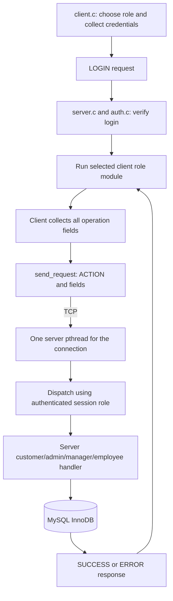
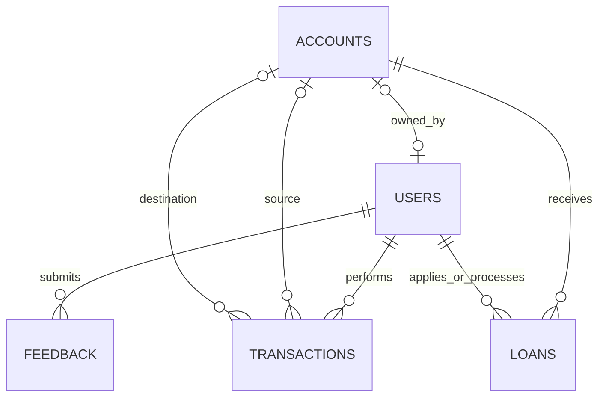

# Architecture

No server-side input prompts are used. All keyboard interaction is in the client.
One authenticated TCP connection is retained until logout. The server owns the
MySQL connection and authorization state. The client holds only socket and login
identifiers needed for its menu.

## One active session per user

Login validates the password and role, then calls GET_LOCK(name,0). Its name uses
an application prefix, a shortened database identifier, and the authenticated user
ID. MySQL atomically accepts only one owner. Credentials and active state are
rechecked before login succeeds. The rule applies to all four roles and to updated
server processes using the same MySQL instance/database.

IS_USED_LOCK(name)=CONNECTION_ID() checks ownership before authenticated actions.
The private database connection retains the login lock across banking transactions.
Logout closes it before acknowledging SUCCESS; disconnect, login
failure after acquisition, and worker cleanup close it as well. MySQL releases
connection-owned named locks on connection termination. Failed ownership validation
ends the client connection. No schema/session-table migration or filesystem lock
is involved. Idle sockets have no application-imposed timeout. Lost network
connections release their ownership after detection.

Reference: [MySQL named lock lifetime](https://dev.mysql.com/doc/refman/8.4/en/locking-functions.html).

## Named request format

Every request is ACTION|field|field followed by a newline. The server validates
field counts, types, roles and account ownership. User/role IDs supplied during
login are checked against MySQL; later operations use the authenticated session.

| Role | Request |
|---|---|
| Login | LOGIN\|role_id\|username\|password |
| Customer | VIEW_BALANCE |
| Customer | DEPOSIT\|amount |
| Customer | WITHDRAW\|amount |
| Customer | TRANSFER\|destination_account\|amount |
| Customer | APPLY_LOAN\|amount |
| Customer | REPAY_LOAN\|loan_id\|amount |
| Customer | VIEW_HISTORY, VIEW_LOANS |
| Customer | ADD_FEEDBACK\|message |
| Employee | ADD_CUSTOMER\|username\|password\|full_name |
| Employee | MOD_CUSTOMER\|user_id\|full_name |
| Employee | PROCESS_LOAN\|loan_id\|APPROVE_or_REJECT |
| Employee | VIEW_PASSBOOK\|account_id, VIEW_ASSIGNED_LOANS |
| Manager | STATUS_ACCOUNT\|account_id\|0_or_1 |
| Manager | ASSIGN_LOAN\|loan_id\|employee_id |
| Manager | VIEW_LOANS, VIEW_FEEDBACK |
| Administrator | ADD_USER\|role_id_1_to_3\|username\|password\|full_name |
| Administrator | MOD_USER\|user_id\|full_name |
| Administrator | SEARCH_USER\|user_id, DELETE_USER\|user_id |
| Administrator | CLOSE_ACCOUNT\|account_id, VIEW_ACCOUNT\|account_id |
| All authenticated roles | CHANGE_PASS\|new_password, LOGOUT |

ADD_USER accepts only Customer (1), Employee (2), or Manager (3). The server
rejects Administrator (4) creation even if a client sends it directly. The setup
program bank_init.out creates the initial administrator only when none exists.
Administrator login remains available.

Responses begin SUCCESS| or ERROR|, can contain several result lines, and end
with a separate END line. Multiple send/receive calls are handled correctly; TCP
packet boundaries are not treated as application message boundaries.

## Database blueprint

The schema.sql file describes columns and constraints. Creating a customer
creates a new account with a balance of Rs 0.00 in the same transaction. Each
customer has one account, and the UNIQUE constraint on users.account_id prevents
two user records from owning the same account. Staff have a NULL account ID.
Loan assignment points to the processing employee.

## Transaction sequence for a transfer

1. Validate the amount and destination from the complete request.
2. START TRANSACTION and share-lock the active user row.
3. SELECT FOR UPDATE on both accounts in increasing ID order.
4. Debit with a sufficient-funds predicate and credit with a balance-limit predicate.
5. INSERT the transaction history row.
6. COMMIT, or ROLLBACK on any failure.
7. Return the response to the client after the transaction finishes.

The helper functions retain decimal rupees throughout. No C double calculations
or rupee-to-integer-paisa conversion are used. Row locks serialize concurrent
operations affecting the same account, including simultaneous deposits and
transfers. MySQL provides undo/redo logging; durable configuration is documented
in README.md. A lost COMMIT acknowledgement is reported without automatic retries.

